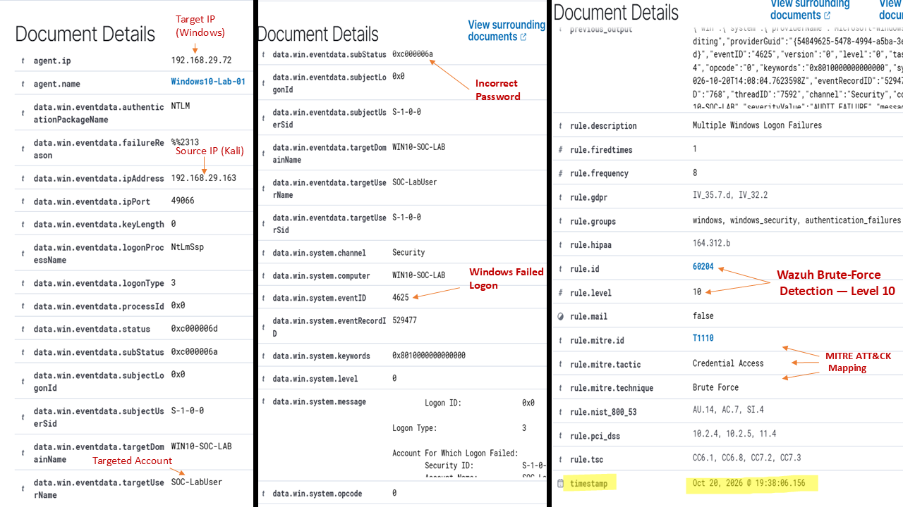
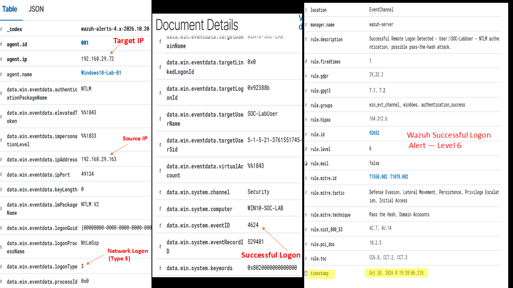
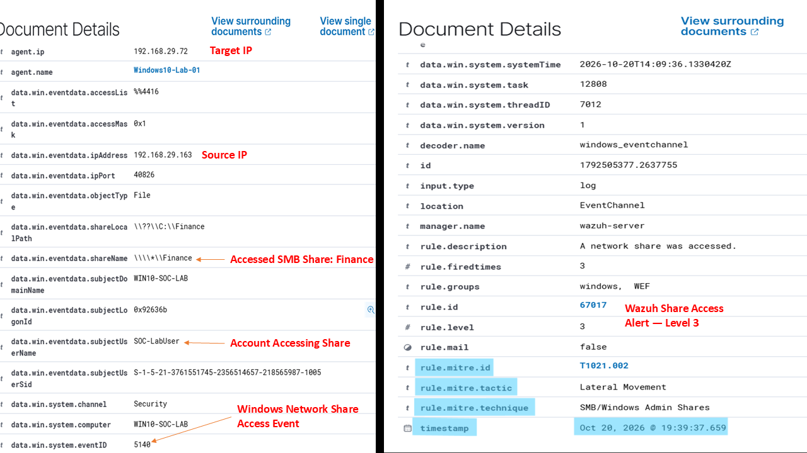

# Investigation Report — SMB Brute-Force and Finance Share Access

## Executive Summary

This investigation covers a controlled home-lab simulation conducted on 20 October 2026. Kali Linux (`192.168.29.163`) was used to simulate repeated SMB authentication failures against a Windows 10 endpoint (`192.168.29.72`).

Wazuh generated an alert for multiple Windows logon failures. A successful network logon for the same lab account and source IP was then recorded, followed by Windows Event ID 5140, which recorded access to the Finance SMB share.

## Scope and environment

| Item | Value |
|---|---|
| SIEM | Wazuh 4.14.7 |
| Monitored agent | `Windows10-Lab-01`, agent ID `001` |
| Windows computer | `WIN10-SOC-LAB` |
| Target IP | `192.168.29.72` |
| Source IP | `192.168.29.163` (Kali Linux) |
| Account | `SOC-LabUser` |
| Service | SMB over TCP/445 |
| SMB share | `Finance` |
| Windows directory behind the share | `C:\Finance` |
| Test file retrieved | `Financial_Report.txt` |

## Timeline

The following timeline shows the events recorded in Wazuh during the SMB lab simulation on 20 October 2026.

| Wazuh Dashboard Timestamp (Local) | Evidence | Description |
|---|---|---|
| 19:38:06.156 | Event ID 4625 — Rule 60204, Level 10 | Multiple failed Windows logon attempts against `SOC-LabUser`. |
| 19:38:06.218 | Event ID 4624 — Rule 92652, Level 6 | Successful network logon for `SOC-LabUser` from `192.168.29.163` using NTLM V2. |
| 19:39:37.659 | Event ID 5140 — Rule 67017, Level 3 | Access to the Finance SMB share by `SOC-LabUser` from `192.168.29.163`. |

## Detection 1 — Multiple Windows logon failures

- **Windows event:** Event ID 4625
- **Wazuh rule:** 60204 — `Multiple Windows Logon Failures`
- **Wazuh level:** 10
- **Dashboard timestamp:** 20 Oct 2026, 19:38:06.156 (local time)
- **MITRE ATT&CK:** T1110 — Brute Force
- **Source IP:** `192.168.29.163`
- **Target account:** `SOC-LabUser`
- **Target endpoint:** `WIN10-SOC-LAB` / `192.168.29.72`
- **Failure details:** status `0xC000006D`, substatus `0xC000006A` (incorrect password)

Wazuh grouped repeated Windows authentication failures into an alert. This is consistent with the controlled password-testing activity shown in the Kali terminal.

**Figure 1 — Wazuh detection of multiple Windows logon failures**

## Detection 2 — Successful network logon

- **Windows event:** Event ID 4624
- **Wazuh rule:** 92652
- **Wazuh level:** 6
- **Dashboard timestamp:** 20 Oct 2026, 19:38:06.218 (local time)
- **Account:** `SOC-LabUser`
- **Source IP:** `192.168.29.163`
- **Target endpoint:** `WIN10-SOC-LAB` / `192.168.29.72`
- **Logon type:** 3 (network)
- **Authentication package:** NTLM V2

The successful event followed the failed logon. The matching account and source IP make this a useful correlation. Logon type 3 is a network logon and should not be described as an RDP logon.

The Wazuh rule description mentions possible Pass-the-Hash activity, but the available event fields do not prove Pass-the-Hash. This alert description should be treated as a lead for further investigation, not a confirmed finding.

**Figure 2 — Successful Windows network logon**

## Detection 3 — Finance SMB share access

- **Windows event:** Event ID 5140
- **Wazuh rule:** 67017 — `A network share was accessed.`
- **Wazuh level:** 3
- **Dashboard timestamp:** 20 Oct 2026, 19:39:37.659 (local time)
- **SMB share:** `Finance` (`\\*\Finance`)
- **Local Windows directory behind the share:** `C:\Finance`
- **Account:** `SOC-LabUser`
- **Source IP:** `192.168.29.163`
- **MITRE mapping shown by Wazuh:** T1021.002

Event ID 5140 records access to a network share. It is not file-specific and does not prove that a particular file was read or downloaded. Wazuh maps this event to T1021.002 (SMB/Windows Admin Shares), but the event identifies the `Finance` share; the mapping alone does not establish that an administrative share was accessed.

**Figure 3 — Windows event recording access to the Finance SMB share**

## File retrieval evidence

The Kali `smbclient` output showed that `Financial_Report.txt` (140 bytes) was successfully retrieved from the Finance SMB share. The file was downloaded to Kali Linux; its contents were not opened or reviewed during this investigation.

**Figure 4 — Retrieval of Financial_Report.txt from the Finance SMB share**

## Key findings

1. Wazuh detected repeated failed Windows logons associated with the controlled SMB test.
2. A successful network logon for the same lab account and source IP followed.
3. Windows Event ID 5140 recorded subsequent access to the Finance SMB share.
4. The Kali `smbclient` output showed retrieval of `Financial_Report.txt`; the file contents were not reviewed.

## Limitations

- The successful-logon alert mentions possible Pass-the-Hash activity, but the available evidence does not confirm it.
- Windows Event ID 5145 was not available in the collected telemetry, so detailed file-share access requests could not be examined using that event.
- Windows Event ID 5140 confirmed access to the Finance SMB share. The Kali terminal output separately confirmed the download of `Financial_Report.txt`. The file contents were not reviewed during this investigation.
- The report covers the events and evidence collected for this simulation; it does not claim that every possible post-authentication activity was investigated.

## Recommendations

1. Use threshold-based alerting for repeated failed logons, with tuning to reduce unnecessary alerts.
2. Correlate failed and successful network logons by account, source IP, endpoint, and time.
3. Enable and validate detailed file-share auditing where appropriate, including Event ID 5145, and confirm the events reach the SIEM.
4. Apply least privilege to SMB share and NTFS permissions; review who can read sensitive shares.
5. Monitor for unexpected SMB access, account changes, and suspicious follow-on process activity.
6. Do not expose passwords or other credentials in public screenshots or reports.
