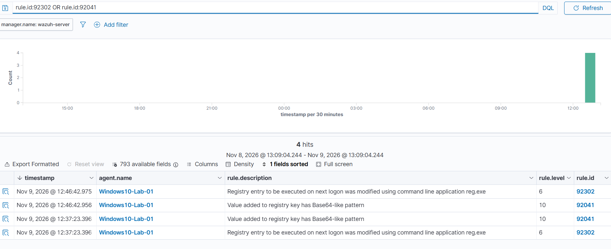
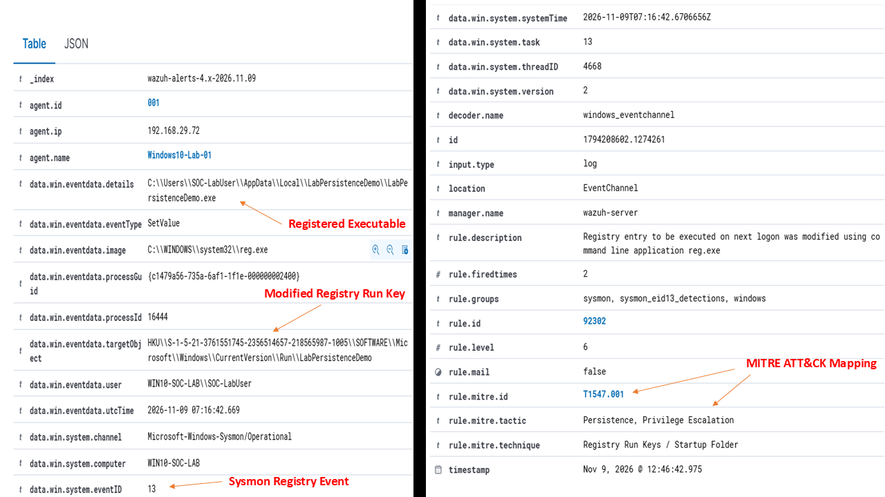
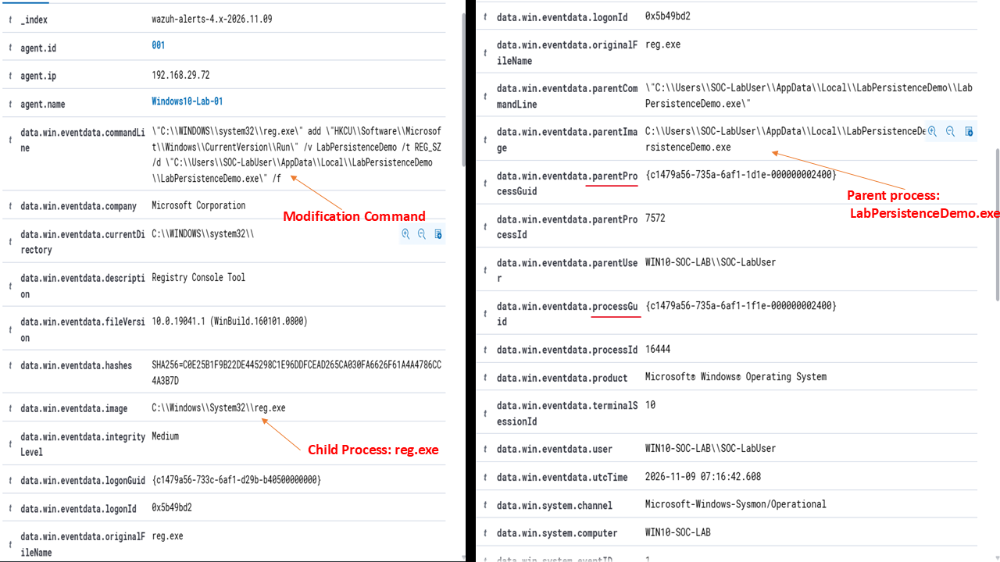

# Investigation Report — Phishing Email and Registry Run Key Persistence

## Executive Summary

This investigation covers a controlled home-lab simulation. A test executable was delivered to a Windows 10 endpoint through a local Mailpit server and launched by the standard user `SOC-LabUser`.

The executable created a Registry Run value pointing to a copy of itself under the user's Local AppData folder. Wazuh detected the Registry modification through **Rule 92302 (Level 6)**, based on Sysmon Event ID 13. Sysmon Event ID 1 recorded the process execution that launched `reg.exe` to create the Run entry.

The Registry entry was also verified after the user signed out and signed back in. The execution log recorded a second run, confirming that the startup entry worked.

## Scope and environment

| Item | Value |
|---|---|
| SIEM | Wazuh 4.14.7 |
| Monitored agent | `Windows10-Lab-01` |
| Windows computer | `WIN10-SOC-LAB` |
| Target IP | `192.168.29.72` |
| Email staging system | Kali Linux with Mailpit |
| Source IP | `192.168.29.163` |
| Account | `SOC-LabUser` (standard user) |
| Executable | `LabPersistenceDemo.exe` |
| Persistence location | `HKCU\\Software\\Microsoft\\Windows\\CurrentVersion\\Run` |
| Sysmon events reviewed | Event ID 1 (Process Create); Event ID 13 (Registry value set) |

## Timeline

The following timeline shows the events recorded during the lab simulation. Times are local to the Windows endpoint (UTC+05:30).

| Timestamp (9 Nov 2026) | Evidence | Description |
|---|---|---|
| 12:37:23 | Sysmon Event ID 1 | `LabPersistenceDemo.exe` launched `reg.exe` under `SOC-LabUser`. |
| 12:37:23 | Sysmon Event ID 13 — Wazuh Rule 92302 | The `LabPersistenceDemo` value was added to the user's Registry Run key. |
| 12:37:23 | Execution log | The executable recorded its initial run under `SOC-LabUser`. |
| 12:46:42 | Execution log and Wazuh timeline | After the user signed out and signed back in, the executable ran again and the Registry activity was detected again. |

**Figure 1 — Wazuh detection timeline for both executions**



## Detection — Registry Run key modification

- **Windows event:** Sysmon Event ID 13 — Registry value set
- **Wazuh rule:** 92302
- **Wazuh level:** 6
- **Event type:** `SetValue`
- **MITRE ATT&CK:** T1547.001 — Registry Run Keys / Startup Folder
- **Affected endpoint:** `WIN10-SOC-LAB` / `192.168.29.72`
- **Account:** `WIN10-SOC-LAB\\SOC-LabUser`
- **Modifying process:** `C:\\Windows\\System32\\reg.exe`

The Sysmon event recorded a Registry value being set under the current user's Run key:

```text
HKCU\\Software\\Microsoft\\Windows\\CurrentVersion\\Run\\LabPersistenceDemo
```

The value data pointed to the installed executable:

```text
C:\\Users\\SOC-LabUser\\AppData\\Local\\LabPersistenceDemo\\LabPersistenceDemo.exe
```

The event identified `reg.exe` as the process that wrote the value and `SOC-LabUser` as the account context. Wazuh generated Rule 92302 for this Registry modification.

**Figure 2 — Wazuh Rule 92302 details for the Registry modification**



## Process creation evidence

Sysmon Event ID 1 recorded the process creation associated with the Registry change.

| Field | Evidence |
|---|---|
| Parent image | `C:\\Users\\SOC-LabUser\\Downloads\\LabPersistenceDemo.exe` |
| Child image | `C:\\Windows\\System32\\reg.exe` |
| Command line | `reg.exe add ... CurrentVersion\\Run ...` |
| User | `WIN10-SOC-LAB\\SOC-LabUser` |
| Integrity level | Medium |

The parent-child relationship shows that the downloaded executable launched `reg.exe`. The process GUID in the Event ID 1 record matched the process GUID in the Registry Event ID 13 record. This links the Registry modification to the process creation event.

The event also showed Medium integrity, consistent with execution under the standard user account rather than an elevated administrator process.

**Figure 3 — Sysmon process creation details**



## Persistence verification

The Registry Run value pointed to the executable under the user's Local AppData folder. The execution log contained two entries:

| Execution | Local timestamp | User |
|---|---|---|
| Initial manual execution | 12:37:23 | `SOC-LabUser` |
| Execution after the next logon | 12:46:42 | `SOC-LabUser` |

The second entry appeared after the user signed out and signed back in. This confirmed that Windows launched the executable through the Registry Run value at the next logon.

The SHA256 hash recorded for the lab executable was:

```text
365A0913BB6731BBCBAF2A0D64D7BB751D5185A4CC04D7AB260C8AE6DC179B22
```

## Key findings

1. The phishing-style email was received through the local Mailpit server, and the executable was downloaded to the Windows endpoint.
2. `LabPersistenceDemo.exe` ran under the standard account `SOC-LabUser`.
3. Sysmon Event ID 1 recorded the executable launching `reg.exe`.
4. Sysmon Event ID 13 recorded the Registry Run value being set, and Wazuh generated Rule 92302.
5. The Registry Run value pointed to the copy of the executable under the user's Local AppData folder.
6. The execution log recorded a second run after the next logon, confirming that the persistence mechanism worked.

## Analysis and Conclusion

The investigation is classified as a **True Positive for the simulated Registry persistence behavior**. The executable created a Run key value, Sysmon recorded the Registry modification, and Wazuh generated the expected Rule 92302 alert. Process creation evidence connected the downloaded executable to the `reg.exe` command that modified the Registry. The second execution after signing back in confirmed that the Run entry worked.

This was an authorized, benign home-lab simulation. The result demonstrates detection of the persistence technique; it does not represent a real malware infection or compromise of a production endpoint.

## Containment and Response Recommendations

1. Block the source IP at the firewall if the activity is unauthorized.
2. Disable the affected account temporarily if compromise is suspected.
3. Reset the affected account's password.
4. Remove the unauthorized value from the affected user's Registry Run key.
5. Quarantine or remove the associated executable after preserving its hash and other evidence.
6. Review other Run/RunOnce keys and Startup locations for additional unauthorized entries.
7. Monitor the endpoint for repeated activity after cleanup.
